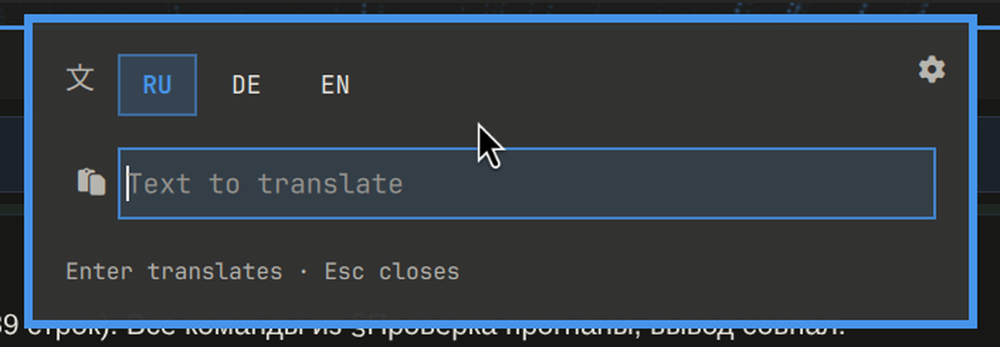

# L1 Translator

A translator in the Omarchy bar: highlight text, press a key, read the translation.



```
$ node scripts/test-model.js | tail -3
ok   history json parses
ok   junk history is empty

ALL PASS
```

- **What it is:** a widget for the Omarchy bar with a popup.
- **What it does:** it translates the text you highlight, or a line you paste or type, and puts the result on the clipboard. Without it you copy every sentence into a browser.
- **What it needs:** a free NVIDIA key from build.nvidia.com, the Omarchy desktop, and `wl-clipboard`.
- **How to start:** run `bash start.sh` in this folder. It copies the widget into `~/.config/omarchy/plugins/` and places it on the bar.

## Install

1. Download the repository as an archive and unpack it whole.
2. In the unpacked folder run `bash start.sh`. It installs the widget and turns it on.
3. Add the hotkey to a file under `~/.config/hypr/bindings/`, then run `hyprctl reload`:

```lua
o.bind("SUPER + Y", "Translate selection", "omarchy-shell -q shell toggle L1-translator")
```

4. Put the key into `~/.config/omarchy/plugins/L1-translator/config.json`, or paste it into the popup's gear screen.

For updates, clone the repository instead: `git clone https://github.com/iliFalk/L1-omarchy-translator && bash L1-omarchy-translator/start.sh` — then `git pull` fetches later versions.

## Use

| Where | What it does |
|---|---|
| `SUPER+Y` | translates the highlighted text and opens the popup |
| bar glyph | opens the popup with the text from before |
| paste icon | fills the line from the clipboard and translates at once |
| copy icon | copies the translation again |
| `History` | folds the last twenty pairs open; a click brings one back |
| `Enter`, `Esc` | translates the typed line, closes the popup |

The target language is not a setting you must find: `RU`, `DE`, `EN` sit in the popup, and the gear carries the other 39.

## Settings

| Path | Holds |
|---|---|
| `~/.config/omarchy/plugins/L1-translator/config.json` | `apiKey`, `model`, `fallbackModel`, `endpoint`, `maxChars` |
| the popup's gear icon | the same fields, and a searchable list of 42 target languages |
| the widget entry in `shell.json` | target language, bar glyph, nothing else |
| `~/.local/state/omarchy/L1-translator-history.json` | the last twenty pairs |

## Docs

- `docs/DEVELOPMENT.md` — models, prompt rules, tests, verification and removal
- `LICENSE` — MIT
